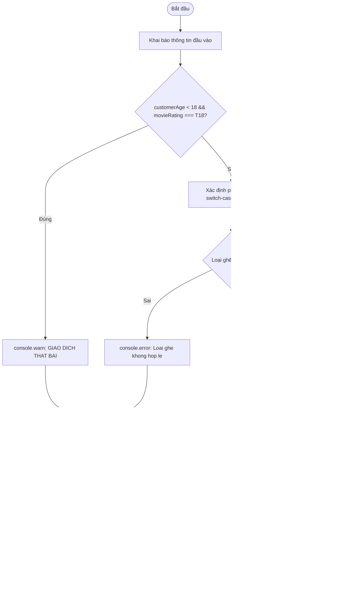

# BÁO CÁO BÀI TẬP: XÂY DỰNG MODULE TÍNH GIÁ VÉ XEM PHIM RẠP CGV VÀ LOTTE

> 👤 **Học viên:** Hoàng Công Dũng | **Mã SV:** PTIT-HCM-009
> 🏫 **Môn học:** it103b-rl-HoangCongDung

---

## 📊 Sơ đồ thiết kế hệ thống (Flowchart)

> 💡 *Sơ đồ dưới đây được render tự động trực tiếp trên GitHub bằng Mermaid. Bạn cũng có thể tải file **`bt1.drawio`** trong repository này để mở và chỉnh sửa trực tiếp trên [Draw.io (diagrams.net)](https://app.diagrams.net).* 

---

## 1. Mục tiêu và Yêu cầu bài toán

Bài tập này được thực hiện nhằm áp dụng thành thạo các kiến thức nền tảng trong JavaScript bao gồm từ khóa khai báo biến let, const, các kiểu dữ liệu nguyên thủy, toán tử so sánh tuyệt đối (===, !==), toán tử logic và các cấu trúc rẽ nhánh (if - else, switch - case, toán tử điều kiện ba ngôi).

Toàn bộ mã nguồn được viết trực quan, kiểm tra chặt chẽ các điều kiện nghiệp vụ thực tế tại quầy bán vé tự động của rạp chiếu phim.

- Sử dụng hằng số UPPER_SNAKE_CASE cho giá cơ sở BASE_PRICE = 80000.
- Tuân thủ nghiêm ngặt quy tắc camelCase cho tất cả các biến đầu vào và kết quả.
- Không sử dụng vòng lặp, mảng, đối tượng hay hàm nhằm bám sát phạm vi kiến thức buổi học.

## 2. Phân tích quy tắc xử lý nghiệp vụ

Quy trình xử lý hóa đơn phải tuần tự đi qua các bước kiểm soát bảo mật và tính toán tài chính:

Kiểm soát độ tuổi: Khách hàng dưới 18 tuổi không được phép xem phim có nhãn T18. Hệ thống phải dừng ngay lập tức và in cảnh báo.

Xác định phụ thu: Sử dụng switch - case dựa trên seatType để phân loại ghế STANDARD, VIP, COUPLE.

Chính sách ưu đãi: Giảm 20% cho học sinh sinh viên xem vào các ngày trong tuần.

Quà tặng kèm: Ghế COUPLE được tặng 01 ly nước ngọt cỡ lớn thông qua toán tử ba ngôi.

- Kiểm tra kỹ lưỡng các nhánh default trong switch-case để phòng ngừa lỗi dữ liệu đầu vào.
- Áp dụng Template Literals để xuất hóa đơn rõ ràng, chuyên nghiệp.

---

## 📁 Danh sách tệp tin nộp bài trong Repository
- 📝 `bt1.docx`: Báo cáo tài liệu phân tích nghiệp vụ hoàn chỉnh.
- 🎨 `bt1.drawio`: File thiết kế sơ đồ chuẩn theo quy định đề bài (mở trực tiếp bằng [Draw.io](https://app.diagrams.net) hoặc Lucidchart).
- 💻 `ticketPricing.js`: Mã nguồn chương trình.
